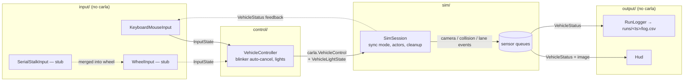

# carla-rig-poc

A keyboard + mouse proof-of-concept for a **driving-simulator rig built on [CARLA](https://carla.org)**.

The final rig will have a steering wheel, pedals, an Arduino turn-signal stalk, a physical
speedometer and several monitors. This PoC runs on a laptop with a keyboard, but is structured so
that moving to real hardware means **replacing one input class** — nothing else in the loop changes.

The code is also meant to be read: every module starts with a docstring saying what it does and what
it may import, and comments are tagged so you can grep for them (see [Comment tags](#comment-tags)).

**New here? Start with the [Tutorial](docs/README.md)**: eight short chapters that give the reading
order, each tagged in git (`chapter-01` … `chapter-08`) so you can see the code grow step by step.

---

## Architecture



ASCII version — one tick of `main.py`:

```
 ┌──────────────┐ InputState ┌──────────────┐ VehicleControl ┌───────────────┐
 │ input/       │───────────▶│ control/     │───────────────▶│ sim/ (CARLA)  │
 │ keyboard/... │            │ vehicle.py   │                │ world.tick()  │
 └──────▲───────┘            └──────────────┘                └──────┬────────┘
        │ on_vehicle_status()                                       │ sensor queues
        │                    ┌──────────────┐  VehicleStatus  ┌─────▼─────────┐
        └────────────────────│ output/      │◀────────────────│ main.py       │
                             │ hud, logger  │   + image       │ frame match   │
                             └──────────────┘                 └───────────────┘
```

| Layer | File(s) | Responsibility | May import `carla`? |
|---|---|---|---|
| Contracts | `state.py` | `InputState`, `VehicleStatus` — the only data crossing layers | no |
| Config | `config.py`, `config/default.yaml` | Load + validate every tunable into dataclasses | no |
| Input | `input/*.py` | Device → `InputState` (`update(dt)`, `close()`) | **no** (tested) |
| Control | `control/vehicle.py` | `InputState` → `carla.VehicleControl`, blinker auto-cancel, lamps | yes |
| Sim | `sim/session.py` | Connect, sync mode, spawn, **always** clean up | yes |
| Output | `output/hud.py`, `output/logger.py` | Draw the frame + instruments; buffered CSV log | no |
| Utils | `utils/frames.py` | Match sensor data to the tick's frame id | no |
| Wiring | `main.py` | Build everything, run the 8-step loop, pace to real time | yes |

**The loop** (`main.py → run_loop`), in this exact order:

1. `inp.update(dt)` → `InputState` (quit check)
2. `controller.apply(vehicle, state)`
3. `frame = world.tick()`; `snapshot = world.get_snapshot()`
4. `wait_for_frame()` for the camera
5. Build `VehicleStatus` (speed = |velocity| × 3.6, pose, collision / lane flags)
6. `hud.render(...)` + `pygame.display.flip()`
7. `logger.write(...)`
8. Pace to real time with `time.perf_counter()`, count overruns

---

## Setup

### 1. CARLA server

Download a CARLA release from <https://github.com/carla-simulator/carla/releases> and extract it,
e.g. to `~/CARLA`. You need a machine with a decent GPU (Linux or Windows; CARLA does not ship macOS
server builds — on a Mac, run the server on another machine and point `server.host` at it).

### 2. Python client — version must match

The `carla` Python package **must be exactly the same version as the server** you run. It is left
commented out in `requirements.txt` on purpose. Create the venv with a Python version that has a
`carla` wheel for your release, then either:

```bash
pip install carla==<your server version>
```

or install the wheel that ships with the server:

```bash
pip install "$CARLA_ROOT"/PythonAPI/carla/dist/carla-*-cp3*-*.whl
```

### 3. This project

```bash
python3 -m venv .venv
```

```bash
source .venv/bin/activate
```

```bash
pip install -r requirements.txt
```

```bash
pip install -e .
```

(`pip install -e .` makes `python -m carla_rig.main` work from anywhere; alternatively prefix
commands with `PYTHONPATH=src`.)

### Tests (no CARLA needed)

```bash
pytest
```

The tests install a fake `carla` module (`tests/fake_carla.py`), so they run on any machine. One
test also checks in a clean interpreter that the input layer never imports `carla`.

---

## Run

Start the server (see `scripts/run_server.sh` for what each flag does):

```bash
CARLA_ROOT=~/CARLA ./scripts/run_server.sh
```

Then the client:

```bash
python -m carla_rig.main --config config/default.yaml
```

On exit, a summary is printed (ticks, real-time factor, overruns) and the log is in
`runs/<timestamp>/log.csv` next to a copy of the resolved `config.yaml`.

### Controls

| Key | Action |
|---|---|
| W | Throttle (ramps up while held, decays on release) |
| S | Brake (ramps) |
| A / D | Steer left / right (eases toward lock, auto-centres) |
| Q / E | Left / right blinker (press again = off, opposite = switch). Auto-cancels after a turn |
| Space | Handbrake (hold) |
| R | Toggle reverse |
| C | Toggle chase / driver camera |
| M | Toggle mouse steering (grabs + hides the cursor; horizontal motion = steer) |
| H | Toggle controls help |
| Esc / close window | Quit (cleanup always runs; Ctrl+C too) |

Ramp rates, mouse sensitivity and the centring spring are in `config/default.yaml → input`.

---

## Comment tags

```bash
grep -rn "SWAP\[" src/         # every hardware / multi-monitor extension point
grep -rn "# TUNE:" src/        # values you'll likely adjust (with their config key)
grep -rn "RESEARCH:" src/      # where experiment-specific logic goes
grep -rn "# WHY:" src/         # non-obvious decisions explained
```

---

## From PoC to real rig

Work through `grep -rn "SWAP\[" src/`; this is the same list grouped by task.

### Wheel + pedals — `SWAP[hardware]`
- [ ] Implement `WheelInput` in `src/carla_rig/input/wheel.py` (the module docstring is a step-by-step guide).
- [ ] Print axis values while moving each control; put the indices in `input.wheel.*` (config, not code).
- [ ] Calibrate: pedal inversion, dead zones, steering lock (`wheel_range_deg`, `max_steer_angle_deg`).
- [ ] Pump pygame events inside `WheelInput.update()` (QUIT / Esc / C / H) — it replaces the keyboard as the only event reader (`input/keyboard_mouse.py`).
- [ ] Set `input.source: wheel`. `make_input_source()` in `main.py` is the only place that selects it.
- [ ] Optional force feedback via `InputSource.on_vehicle_status()` (`input/base.py`).

### Turn-signal stalk / buttons (Arduino) — `SWAP[hardware]`
- [ ] Implement `SerialStalkInput` in `src/carla_rig/input/serial_stalk.py` (protocol `TURN:L` / `TURN:OFF` / `HORN:1`, background reader thread).
- [ ] Merge it into `WheelInput.update()` so `main.py` still sees one `InputSource`.
- [ ] If the stalk cancels mechanically, disable software auto-cancel (`control.blinker_cancel_arm_threshold: 1.0`) — see `control/vehicle.py`.
- [ ] Add `pyserial` to `requirements.txt`.

### Physical speedometer — `SWAP[hardware]`
- [ ] Send `SPD:<kmh>` from `SerialStalkInput.on_vehicle_status()` (`input/serial_stalk.py`).
- [ ] Remove/hide the on-screen gauge in `Hud._draw_speedometer` (`output/hud.py`).

### Multiple monitors — `SWAP[multi-monitor]`
- [ ] **Cameras** (`sim/session.py → _spawn_camera`): one camera per monitor, all at the same eye
      (driver) location, yaw step = `fov + bezel_angle`, each with its own queue; compute each
      `fov = 2·atan((screen_width/2)/eye_distance)`.
- [ ] **Window** (`output/hud.py → Hud.__init__`): one borderless (`NOFRAME`) window spanning the whole
      desktop at position 0,0 — not one window per screen.
- [ ] **Rendering** (`output/hud.py → _draw_camera`): blit each camera's image at `x = i × monitor_width`; HUD on the centre screen.
- [ ] **Loop** (`main.py`): `wait_for_frame` on every camera queue; still **one** `display.flip()` per frame; decide what camera toggle means.
- [ ] Add a `monitors:` section to `config/default.yaml` + `config.py` (count, width, eye distance, bezel width).

### Research — `RESEARCH:`
- [ ] Scripted scenarios / ScenarioRunner instead of random NPCs (`sim/session.py → _spawn_npcs`).
- [ ] Extra measures (time headway, distance to lead vehicle) in `main.py` step 5 + `state.VehicleStatus` + `output/logger.csv_columns`.
- [ ] Participant ID / condition: `logging.participant_id`, `logging.condition` (written to every row).

---

## Troubleshooting

**The server is frozen / the next client hangs after a crash.**
The world was left in synchronous mode: the server waits forever for a `tick()` that never comes.
This client always restores settings on exit (Esc, window close, Ctrl+C, SIGTERM, exceptions), but a
`kill -9` or a power cut can't be caught. Fix: restart the server, or run once from a Python shell:
```python
import carla; c = carla.Client("localhost", 2000); w = c.get_world()
s = w.get_settings(); s.synchronous_mode = False; s.fixed_delta_seconds = None; w.apply_settings(s)
```

**`version mismatch` warning, RPC errors, or a crash right after connecting.**
The `carla` client and the server differ. Check with `pip show carla` and the server's release
number; reinstall the matching client wheel (see Setup → 2).

**Low FPS / red OVERRUN tag / real-time factor < 1 in the summary.**
A tick took longer than `world.fixed_delta_seconds` of wall time, so the world runs slower than real
time. Try, roughly in order: server `-quality-level=Low`; smaller `camera.width/height` (and set them
equal to `hud.window_*` to avoid scaling); fewer `world.npc_vehicles` or `tm_hybrid_physics: true`;
a larger `fixed_delta_seconds` (e.g. 0.05 → 0.0667, keeping the substep rule); run the server on a
separate GPU machine. The summary's `worst` loop time tells you how far over budget you are.

**Black screen.**
`world.no_rendering_mode` must be `false` (the config validator enforces this, but another client or
script may have set it on the server — restart the server). `-RenderOffScreen` is fine: it only
hides the server window, cameras still render. Also check the log for `FrameTimeoutError`.

**`spawn failed` / collision at spawn point.**
Another actor (often a leftover from a crashed run) is on that spawn point. Restart the server or
change `vehicle.spawn_index`.

**`FrameTimeoutError: sensor skipped frame`.**
Another client is also ticking the world (only one client may call `tick()` in sync mode), or the
camera's `sensor_tick` was changed.
